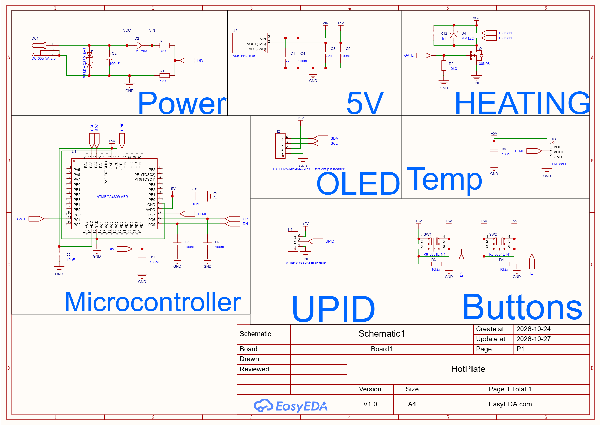

# HotPlate
**Its a DIY hotplate that makes soldering smd components very easy. And makes it cheaper because no one wants to buy those expensive hotplates**


##  Overview

**What is that?**

A DIY hot plate is a homemade heater, usually a PCB with a long copper trace that heats up when current flows through it. A MOSFET switches the power on and off to control the temperature, using feedback from a temperature sensor. It’s used for soldering, preheating boards, and curing small parts.

## Cost 


| Name          | Description                                                                   | Price  | Shipping+tariff |
| ------------- | ----------------------------------------------------------------------------- | ------ | -------- |
| Componenets   | Components from LCSC. Detailed breakdown [here](/BOM/export_cart_20261027_215536.csv) | $21.93  | $36.97   |
| PCB+Stencil   | PCB and stencil from JLC                                                      | $10.03 | $32.88   |
| **Sub Total** |                                                                               | $31.96 | $69.85   |
| **Total**     |                                                                               | $101.81 |          |


## Schematics

**This project was made on EasyEDA**





## Repo structure

```
├── EasyEDA/      EasyEDA file
├── BOM/          BOM file
├── Gerber/       Gerber file
├── PickAndPlace/ PickAndPlace file
├── schematics/   Schematic image
├── Firmware/     Firmware
└── images/       photos and renders

```
